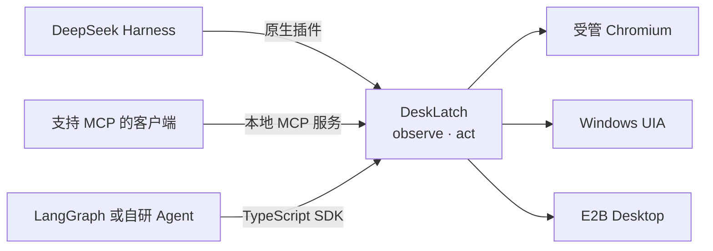

# 接入 DeskLatch

DeskLatch 用 `observe` 和 `act` 接入 Agent，宿主可选开 `run_code`。同一个会话处理应用授权、窗口绑定、目标定位、风险判断、审批、动作执行与回执。宿主提供模型、Agent Loop 和用户交互。



## DeepSeek Harness 原生插件

Windows 使用 [安装向导](../distribution/windows/README.md)。先启动 DSH 桌面版完成首次初始化，再从系统托盘完全退出。运行向导，选择原生插件，安装完成后打开授权页并勾选应用。经验证的版本为 DSH `0.2.2-rc.5`。

Windows 官方桌面版的 `resources/runtime/cli/bin/dsh.cmd` 位于应用安装目录，可用脚本全路径运行该命令。重新打开 DSH，在 **设置 → 模型** 选择已配置的模型即可试用。 [官方插件命令](https://github.com/deepseek-ai/deepseek-harness/blob/master/apps/cli/reference/README.md) · [模型配置](https://github.com/deepseek-ai/deepseek-harness/blob/master/docs/user/guide/providers.md)

DSH 加载安装包里的 `dsh.bundle.patch`，挂载 Cordis 插件，注册 `desklatch_observe` 和 `desklatch_act`。Windows 插件加载 CUA 和授权页保存的应用范围。发生审批时，插件把等待请求交给 DSH 的会话审批服务，由用户决定是否恢复原动作。

已有 DSH Agent 循环的应用可以自行给插件提供已授权的会话。下例中的 `openDeskSession` 由宿主实现，并把回调传给 `createDeskSession`。

```js
import { createDeskDshApprovalBridge, createDeskDshPlugin } from "desklatch/dsh";

const handle = await ctx.agents.create({
  sessionId,
  agentOptions: { provider, model },
  async setup(agentCtx) {
    const approval = createDeskDshApprovalBridge(agentCtx);
    const plugin = agentCtx.plugin(createDeskDshPlugin(
      () => openDeskSession({ onApprovalRequested: approval.onApprovalRequested }),
      { approval },
    ));
    await plugin.await();
  },
});
```

通过 DSH 的 Agent 发送任务，用完后调用 `handle.dispose()` 释放 Agent 和会话。 [独立 DSH 接入示例](../examples/frameworks/dsh.mjs)

## MCP 客户端

支持本地 stdio MCP 的客户端可使用 Windows 向导生成的配置。也可以在 Node.js 22.19 或更高版本下，下载核心包并在新目录运行以下命令。

```sh
npm install --omit=optional /path/to/desklatch.tgz
npm exec -- desklatch-setup mcp --windows --install
```

在授权页保存应用范围，再将 `desklatch.mcp.json` 中的 `mcpServers.desklatch` 导入客户端。Windows 配置会加载本机操作后端，关键动作通过 Windows 审批窗口确认。经 DSH 的官方 MCP 客户端使用时，可以从安装目录的 `desklatch.dsh-mcp.yml` 复制 `servers.desklatch` 配置，替换现有同名条目，工具调用带 `mcp__desklatch__` 前缀。[DSH 的 MCP 接入](https://github.com/deepseek-ai/deepseek-harness/blob/master/docs/subsystems/mcp.md)

在工具可用的会话中，先让 Agent 读取 `observe({workspace:true})`。它会看到允许操作的应用，通过 `act({activate:应用ID})` 切换，之后按当前应用的能力执行任务。用户可在安装目录打开 `DeskLatch-Authorize.cmd` 来调整授权。选装的本机 OCR 和 E2B 继续由同一个服务使用。要启用 Code Mode，在 `mcpServers.desklatch.env` 加入 `"DESKLATCH_CODE_MODE": "1"` 后重连服务。[Code Mode 接入](code-mode.md)

`desklatch-mcp --demo` 用于隔离浏览器示例。要接入应用自己的桌面，可以给启动命令传入宿主模块的绝对路径。模块导出 `openDeskSession()`，返回当前授权的会话。宿主也可以直接创建 `createDeskMcpServer(endpoints)`，连接自己的 MCP transport。会话通过 `onApprovalRequested` 回调交出待确认的动作。宿主展示请求后调用 `resolveApproval` 回传用户决定。[MCP 宿主示例](../examples/frameworks/browser-host.mjs)

## TypeScript SDK

在宿主项目安装 [Release 的核心包](https://github.com/wszkxlllll/desklatch/releases/tag/v0.1.0-dev.2)，再安装实际使用的框架和驱动。下面的 `page` 是宿主已打开且授权的 Playwright Page，`allowedOrigin` 是允许操作的来源。

```ts
import { createDeskSession, createDeskTools } from "desklatch";
import { createBrowserBackend } from "desklatch/browser";
import { createLangChainTools } from "desklatch/langchain";
import { ToolNode } from "@langchain/langgraph/prebuilt";

const session = createDeskSession(createBrowserBackend(page, {
  authorizedOrigins: [allowedOrigin],
}));
const endpoints = createDeskTools(session);
const toolNode = new ToolNode(createLangChainTools(endpoints));
// Register toolNode with the existing graph. At teardown: await session.close().
```

OpenAI Agents SDK 可以用 `createOpenAIAgentsTools(endpoints)` 把工具交给自己的 `Agent.tools`。其他 TypeScript 宿主直接调用 `createDeskTools(session)` 返回的工具定义及执行入口。多应用共用一个会话时，通过 `createWorkspace({ applications })` 登记授权应用。应用可以绑定已打开的桌面会话，也可以在第一次选中时由宿主接入。[LangGraph 接入示例](../examples/frameworks/langgraph.mjs) · [工作区接口](architecture.md#多个应用共用的工作区)

应用可通过 `canAutomate` 接入应用和窗口排除设置。在本仓库构建后运行 `node examples/automation-settings/server.mjs`，打开终端显示的地址即可试用设置页。[应用和窗口排除设置](architecture.md#应用和窗口排除设置)

使用智谱 Chat Completions 的 LangGraph 宿主，可以在模型调用前使用 `prepareDeskChatCompletionsMessages(messages)` 投递获准的图片，同时保留原始工具回复和调用编号。[模型接入示例](../examples/zhipu-acceptance.mjs)

### 把审批接到自己的界面

每个 Agent 会话保存自己的审批记录。收到申请时，宿主通过自己的界面显示动作摘要、上下文和截止时间。按钮事件回到同一个宿主会话，再由 DeskLatch 复查实际对象及当前权限，继续原来的动作。

```ts
import { createDeskSession, createDeskTools } from "desklatch";
import type { ApprovalDecision, ApprovalRequest, DesktopBackend } from "desklatch";

type ApprovalCard = Pick<ApprovalRequest, "requestId" | "summary" | "contextSummary" | "expiresAt">;

export function connectDesktop(backend: DesktopBackend, showCard: (card: ApprovalCard) => void) {
  const pending = new Map<string, ApprovalCard>();
  const session = createDeskSession(backend, {
    onApprovalRequested({ requestId, summary, contextSummary, expiresAt }) {
      const card = { requestId, summary, contextSummary, expiresAt };
      pending.set(requestId, card);
      showCard(card);
    },
  });

  async function decide(requestId: string, decision: ApprovalDecision) {
    const card = pending.get(requestId);
    if (!card) throw new Error("approval_not_found_in_this_session");
    pending.delete(requestId);
    return session.resolveApproval(requestId, decision);
  }

  return {
    session,
    tools: createDeskTools(session),
    decide,
    async close() { pending.clear(); await session.close(); },
  };
}
```

1. 用 `showCard` 发 UI 事件或更新当前页面。批准按钮传 `approve`，拒绝按钮传 `deny`。按钮通过宿主认证的用户会话调用 `decide`，到达 `expiresAt` 后在界面标为过期。
2. Agent Loop 收到 `approval_required` 时保存当前运行并暂停。收到用户决定后，把 `decide` 返回的 `status`、`code` 和 `steps` 一并交回同一个运行。DeskLatch 已处理原动作的批准或拒绝。如出现新的审批卡，就等待下一次决定。
3. 多应用宿主改用 `workspace.resolveApproval`，让审批回到发起动作的应用。每个 Agent 结束时调用 `close()`。注册 `tools` 时使用 LangGraph、OpenAI Agents SDK 或自研适配方式。[审批与回执验收](../test/host-approval-acceptance.test.mjs)

## 工具接口

| 工具 | 常见用法 |
| --- | --- |
| `observe` | 使用 `{workspace:true}` 列出可选应用，或读取当前界面的控件、正文和获准的截图 |
| `act` | 使用 `{activate:"editor"}` 切换到已登记的编辑器，使用 `{navigate:url}` 打开获准的网址，或使用 `{steps:[...]}` 操作当前界面 |
| `run_code` | 宿主开启后，运行依次调用 `desk.observe` 和 `desk.act` 的隔离程序，返回筛选后的结果和回执 |

目标明确时，可一次提交多个动作。执行器逐步查找实际控件、核对风险，并读取 `expect` 所指的结果。

```json
{
  "steps": [
    { "kind": "type", "target": { "name": "Title" }, "text": "Review" },
    {
      "kind": "type",
      "target": { "name": "Notes" },
      "text": "Approved draft",
      "expect": { "target": { "name": "Notes" }, "valueEquals": "Approved draft" }
    }
  ]
}
```

使用截图坐标、控件引用或拖拽端点时，需要带上 `observationId`。后端公布支持的动作与参数组合。网页正文需要浏览器后端和会话均授权读取，之后用 `observe({read:{query:"停止入场"}})` 查找，或把 `nextCursor` 作为 `read.cursor` 续读。宿主可用 `desklatch/reuse` 开启已核验步骤的记录与复用。[动作输入契约](../schema/act-input.schema.json) · [执行架构](architecture.md)

Windows 控件可返回 `windowScope`。将它填进目标的 `within`，可把 `role + name` 查找限定到该已授权窗口。已知目标时直接提交 `act`，唯一性、窗口归属和执行准入由 DeskLatch 检查。工作区清单中的 `activeCapabilities` 给出当前应用支持的动作。

## 选装与验收

Windows 向导里可单独选择 OCR 和 E2B。授权页可独立允许本机识别已授权窗口的局部文字，以及向模型提供全桌面截图。会话切换到 E2B 应用时才创建云电脑。 [可选组件配置](setup-optional.md)

Windows 宿主可以通过 `DESKLATCH_LOCAL_BROWSER_ORIGINS` 开启本机受管 Chromium。值是逗号分隔的站点来源，例如 `https://docs.python.org,https://www.shanghaimuseum.cn`。MCP 客户端可在 `mcpServers.desklatch.env` 中设置。Agent 选中 `windows-local-browser` 后，宿主才启动独立浏览器会话，并将主页面操作限制在所配置的来源。

运行 `npm run pack:install -- ./distribution/out` 生成核心包、DSH 包和 Windows 向导。普通 `npm test` 可离线运行。真实模型或 E2B 测试的密钥、运行条件和结束清理见验收记录。[可复跑测试](verification.md#复跑)
